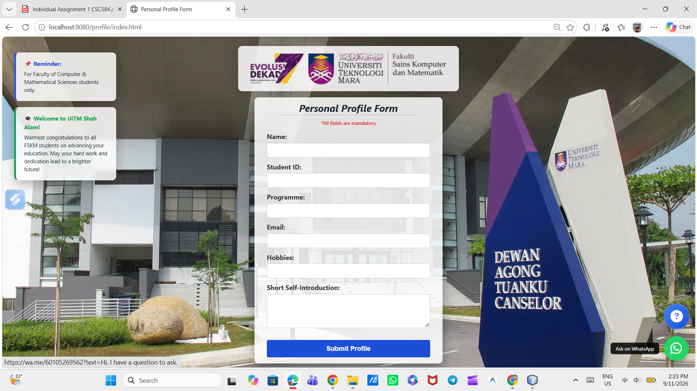

CSC584-Individual-Assignment-1
This Java based student profile web app uses HTML, CSS, and JSP for its interface, while Java Servlets/JSP handle back end logic. Built using NetBeans, it runs on Tomcat server. To execute, open the project in NetBeans, select Clean and Build, then click Run. Access it via browser at http://localhost:8080/profile/ to submit data.

## Project Description
This is a web-based student profile application built for CSC584 Individual Assignment 1. The system lets students from the Faculty of Computer & Mathematical Sciences (FSKM) at UiTM Shah Alam fill in their profile details using an online form and displays the submitted data neatly on a profile card.

---

## Technologies Used
- **Programming Language:** Java (Servlet) & JSP (JavaServer Pages)
- **Frontend:** HTML5, CSS3, JavaScript
- **IDE:** NetBeans IDE
- **Server:** Apache Tomcat Server (v8.5 / v9.0 / v10.0)

---

## How to Run the Application

Follow these simple steps to run the application on your computer:

1. **Download / Clone Project:**
   - Download this repository as a ZIP file or clone it using Git:
     git clone [https://github.com/pejalcoco/CSC584-Individual-Assignment-1.git](https://github.com/pejalcoco/CSC584-Individual-Assignment-1.git)
   

2. **Open in NetBeans:**
   - Open **NetBeans IDE**.
   - Click `File` > `Open Project...` and choose the project folder.

3. **Check Server Configuration:**
   - Right click on the project name > select `Properties` > click `Run`.
   - Make sure **Apache Tomcat** is selected as the target server.

4. **Build and Run:**
   - Right click the project folder and click **Clean and Build**.
   - Press the green **Run** button (or press `F6`).

5. **Open in Browser:**
   - After Tomcat starts, open your browser and go to:
     http://localhost:8080/CSC584-Individual-Assignment-1/
    

---

## How the Code Works (Simple Flow)
1. **User Input (`index.html`):** User enters details (Name, Student ID, Programme, Email, Hobbies, Short Intro).
2. **Backend Processing (`ProfileServlet.java`):** Servlet reads the inputs using `request.getParameter()` and attaches them to `request.setAttribute()`.
3. **Display Output (`ProfileInfo.jsp`):** Servlet forwards the request to JSP, which displays the user details inside a formatted profile card using JSP expressions (`<%= request.getAttribute(...) %>`).

---

## 📸 Output Screenshots

### 1. Form Page (`index.html`)

### 2. Result Page (`ProfileInfo.jsp`)
2
